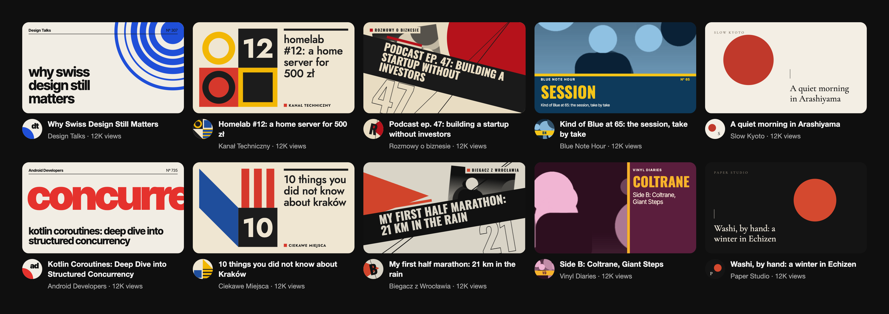
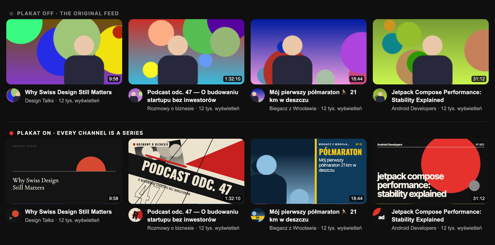
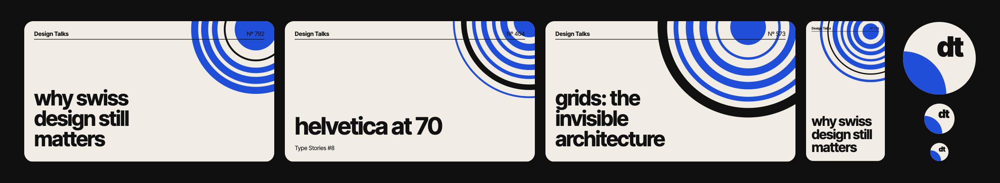
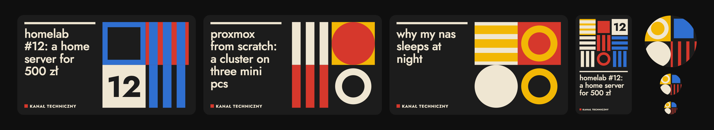
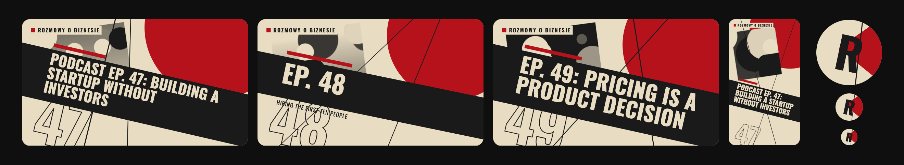
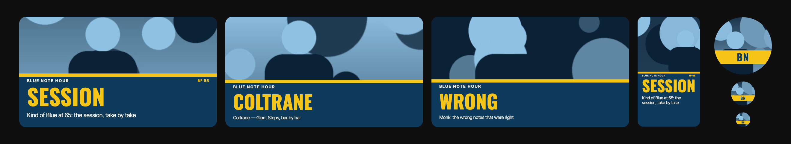
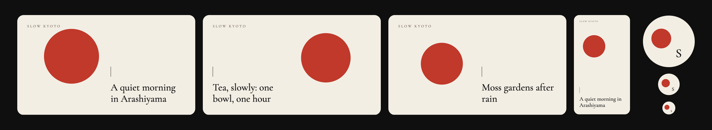
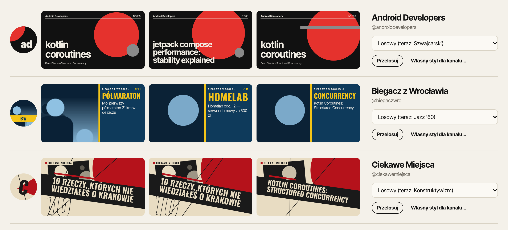
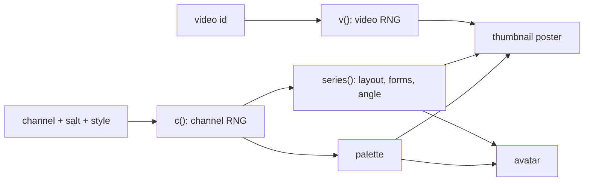

<p align="center">
  
</p>

<h1 align="center">Plakat</h1>

<p align="center">
  <b>YouTube thumbnails and channel avatars, redrawn as posters.</b><br>
  Every channel becomes a series. Every video is a variant of it.
</p>

<p align="center">
  Chrome extension · Manifest V3 · no build step · no external services · deterministic
</p>

---

Plakat replaces the thumbnails on YouTube with generative posters in five design traditions: **Swiss**, **Bauhaus**, **Constructivism**, a **'60s jazz sleeve** and Japanese **Ma 間** minimalism. The style, palette and layout come from the channel's seed, so a channel always looks like itself, while each video gets its own composition. Channel avatars are drawn from the same series, so the circle next to the title matches the poster above it.

<p align="center">
  
</p>

## Highlights

- **One channel, one series.** A seeded RNG per channel picks the palette and the series traits (layout, form vocabulary, tilt). A second RNG per video varies positions and sizes.
- **Avatars that belong.** Avatars next to videos, in search results, in the subscriptions menu, on the watch page and in the channel header use the channel's palette and forms. Comment authors keep their own faces unless you ask otherwise.
- **Reads the title.** Strips emoji and hashtags, splits "Title | subtitle", pulls out episode numbers (`#12`, `odc. 47`, `ep 5`) and the strongest word, and sets type to fit.
- **Stays out of the way.** Hover shows the original, Alt+Shift+P toggles everything, YouTube's duration and progress badges stay on top.
- **Yours to edit.** Pin a style per channel, reroll a series, or build your own style in the editor and share it as JSON.

## Styles

**Swiss** · grid, grotesque type, a giant number, a circle or rings. Avatar: a monogram beside a quarter circle.


**Bauhaus** · a grid of primitives in primary colours, lowercase type. Avatar: four shapes from the channel's vocabulary.


**Constructivism** · diagonals, a red wedge or circle, a title band, photomontage. Avatar: the wedge and the initial at the channel's angle.


**Jazz '60** · a record sleeve: duotone photo, a block of colour, one huge word. Avatar: the original avatar in duotone with initials on a bar.


**Ma 間** · emptiness, a single circle, a serif title, a hairline. Avatar: one circle off centre and a small initial.


## Install

Plakat is not in the Chrome Web Store yet. Load it unpacked:

1. Clone this repository.
2. Open `chrome://extensions` and turn on **Developer mode**.
3. Click **Load unpacked** and pick the folder with `manifest.json`.
4. Open YouTube, or reload the tab if it was already open.

## Use

The interface is in Polish.

| | |
|---|---|
| **Hover** | shows the original thumbnail or avatar (can be turned off) |
| **Alt+Shift+P** | turns posters on and off on the page |
| **Ogólne** | on/off, hover reveal, channel avatars, avatars in comments |
| **Kanały** | every channel you have seen, with its avatar and three posters on its real titles; pin a style or reroll the series |
| **Style** | choose which styles take part in the draw, duplicate one to edit it, import and export JSON |
| **Editor** | engine, typeface, case, composition, channel name, numbers, duotone photo, density and palettes, previewed on a channel's recent videos and its avatar at 96, 40 and 24 px |

<p align="center">
  
</p>

## How it works



- **Seeds.** `rng("c|channel|salt|style")` picks the palette and feeds the engine's `series()`. `rng("v|video|salt|style")` drives each video's variant and `rng("a|channel|salt|style")` the avatar's. A channel without a pinned style gets one from the pool through `rng("pool|channel|salt")`. Thumbnails and avatars run the same `series()`, which is why they always match.
- **Rendering.** Engines return a virtual SVG tree (`h(tag, attrs, ...children)`), which the content script builds with `createElementNS`. YouTube enforces Trusted Types, so there is no `innerHTML` anywhere.
- **YouTube's DOM.** Selectors follow links, ids and custom element names, never class names, which YouTube renames often. Thumbnails are any `/watch?v=` or `/shorts/` link around an ``; avatars are keyed by the nearest `/@handle` or `/channel/…` link. Overlays sit right after the original image and carry a signature that catches recycled elements; an `IntersectionObserver` per pass and a render cache keep scrolling smooth.

## Architecture

Classic scripts sharing `globalThis.Plakat`, no bundler. The load order in `manifest.json` is also the dependency order, and each layer only uses the ones before it.

```
src/core/       primitives: seeded RNG, virtual SVG, colour, typography, title analysis, i18n
src/engines/    the five style engines and their shared kit
src/poster/     built-in styles and the render pipeline (P.render, P.renderAvatar)
src/store/      settings and seen channels in chrome.storage.local
src/content/    YouTube adapter: selectors, overlays, thumbnail and avatar passes
options/        options page and style editor
popup/          toolbar popup
_locales/pl/    every user-facing string
dev/            style gallery, YouTube mock, end-to-end tests
```

### Writing a style engine

Create `src/engines/<id>.js` and register it:

```js
P.defineEngine('<id>', {
  label, comps, defaults,
  series(x) { /* channel traits, drawn only from x.c() and x.comp(n) */ },
  render(x) { /* thumbnail nodes; per-video variation from x.v() */ },
  renderAvatar(x) { /* 100×100 nodes shown in a circle; x.initials, x.thumbUrl */ },
});
```

Then add the file to `manifest.json`, `options/options.html`, `popup/popup.html` and `dev/gallery.html` (the e2e test checks that these lists agree), add its labels to `_locales/pl/messages.json`, and append a built-in style at the end of `src/poster/styles.js`. Never reorder `c()` calls or built-in styles: both are part of the seed and would restyle every existing channel.

## Development

- **Gallery.** Open `dev/gallery.html?style=<id>` from disk to see every variant of a style, with each channel's avatar under its poster and at 96, 40 and 24 px. Add `&salt=<n>` to shift all seeds.
- **End-to-end tests.** `python3 dev/e2e.py [editor]` launches Chromium with the extension against `dev/mock-youtube.html`: old and new YouTube DOM, Shorts, search, the player, the watch page owner, guide subscriptions, comments, the channel header, element recycling, late hydration and Trusted Types. It prints one line per assertion and saves screenshots to `$TMPDIR/plakat-e2e/`. Needs `pip install playwright && playwright install chromium`.

## Roadmap

- Music titles ("Artist - Song") should feature the song, not the artist.
- Auto-levels for duotone photos on dark thumbnails.
- A safe zone for YouTube's duration badge in every engine.
- Keyword and mood from the title with Gemini Nano (Prompt API in Chrome).
- More testing on live YouTube: the home page, the watch page sidebar and avatars are so far verified on the mock.

## Credits

Typefaces: [Inter Tight](https://fontsource.org/fonts/inter-tight), [Jost](https://fontsource.org/fonts/jost), [Oswald](https://fontsource.org/fonts/oswald) and [Cormorant Garamond](https://fontsource.org/fonts/cormorant-garamond), bundled from Fontsource under the SIL Open Font License 1.1.
